# FP&A Analytics in Microsoft Fabric – Budget vs Actual

End-to-end financial planning & analysis solution built on **Microsoft Fabric**: from raw ERP exports and an Excel budget to a Direct Lake semantic model and a Power BI report explaining **why** results differ from the budget.

**New:** a 2027 sales plan built with **Fabric Plan** – planning sheet, writeback to a Fabric SQL Database, stock and capacity check and EUR/PLN scenarios ([jump to section](#extension-sales-plan-2027-with-fabric-plan-and-writeback)).

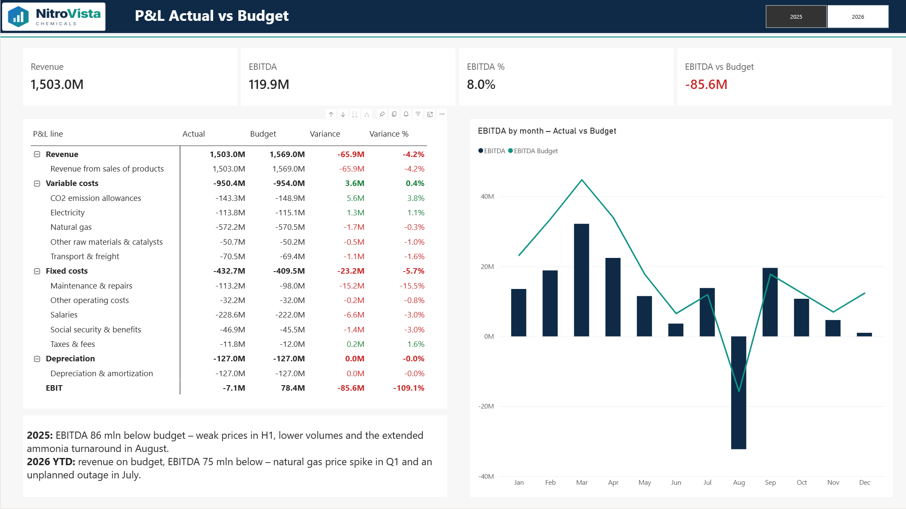

---

## Business scenario

**NitroVista Chemicals S.A.** (fictional) produces nitrogen fertilizers and industrial chemicals and sells them in Poland (PLN) and across the EU (EUR). Management asks every month:

* How do revenue, contribution margin and EBITDA compare with the budget?
* Is the revenue gap caused by **lower volumes, lower prices or the EUR/PLN rate**?
* Which cost centers and cost types drive the overruns (natural gas, CO₂, maintenance)?

In the data you will find a realistic story: weak prices in H1 2025, an ammonia plant turnaround that took longer than planned (Aug 2025), a natural gas price spike in Q1 2026, strong export prices in Q2 2026 and an unplanned outage at the nitrates unit (Jul 2026).

## Report

**Executive summary** – KPI cards, P&L Actual vs Budget with drill-down to accounts, monthly EBITDA vs budget (screenshot above).

**Revenue bridge** – budget-to-actual waterfall (volume, price, FX), effects by product and by month.

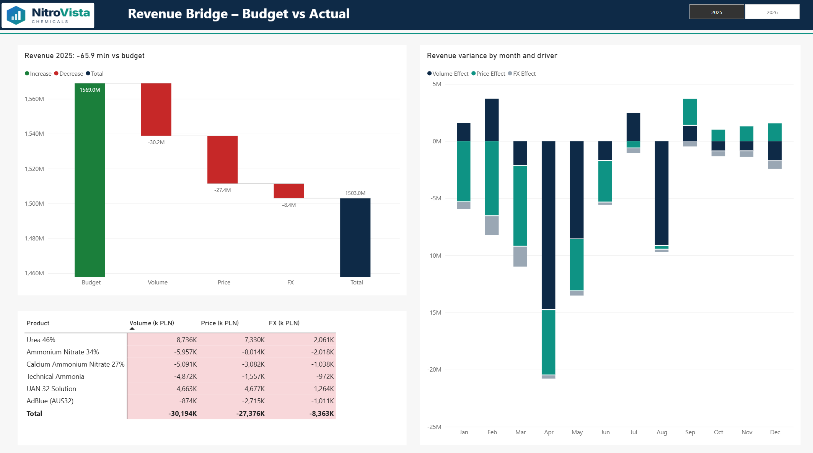

### What the report shows

| | 2025 | 2026 YTD (Jan–Aug) |
|---|---|---|
| Revenue vs budget | −66 m PLN (volume −30, price −27, FX −8) | +9 m PLN |
| EBITDA vs budget | −86 m PLN | −75 m PLN |
| Main drivers | weak prices in H1, dry spring, extended ammonia turnaround in August | natural gas price spike in Q1 (−67 m PLN), unplanned outage in July |

## Architecture

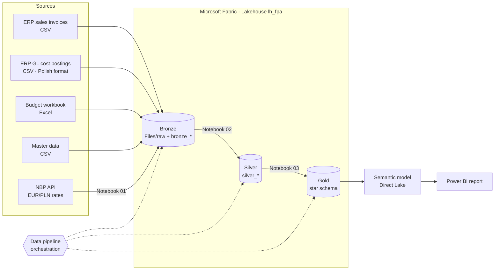

| Layer | What happens | Tool |
|---|---|---|
| Bronze | Raw files kept as delivered; NBP rates downloaded from the public API in 93-day chunks | Lakehouse Files, PySpark notebook |
| Silver | De-duplication, type casting, Polish number/date formats, unpivot of budget months, daily FX calendar with the *previous business day* rule | PySpark notebook |
| Gold | Star schema: `fact_pnl` (Actual + Budget), `fact_sales`, `fact_revenue_bridge` + dimensions | PySpark notebook |
| Serving | Direct Lake semantic model with DAX measures, Power BI report | Power BI |
| Orchestration | Pipeline runs notebooks 01 → 02 → 03 | Data Factory pipeline |

Pipeline run (notebooks 01 → 02 → 03 in one high-concurrency Spark session, with retry policy):

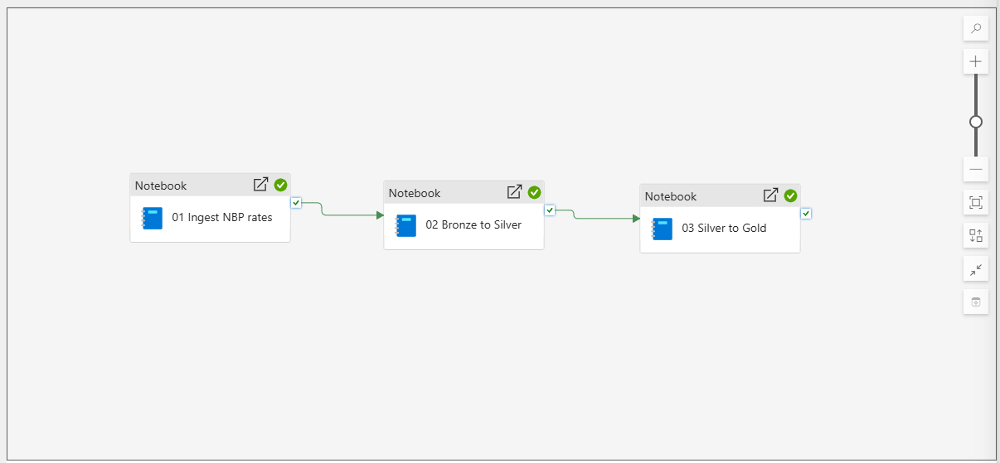

## Key features

* **Revenue variance bridge** – budget-to-actual revenue split into volume, price and FX effects for every product × market × month, reconciled to the cent.
* **Real exchange rates** – EUR invoices converted with official **NBP** average rates from the business day preceding the invoice date (Polish VAT/CIT rule).
* **Single P&L fact** – Actual and Budget in one table with a consistent sign convention (revenue +, costs −), so every subtotal is a plain sum and a positive variance is always favourable.
* **Realistic data quality issues** – duplicated export rows, inconsistent customer codes, a semicolon-separated ERP file with decimal commas and `dd.mm.yyyy` dates, a budget with months as columns.
* **Fair in-year comparison** – budget measures limited to closed months.

## Data model

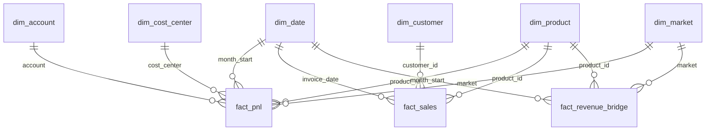

DAX measures and model settings: [semantic-model/model_and_measures.md](semantic-model/model_and_measures.md)

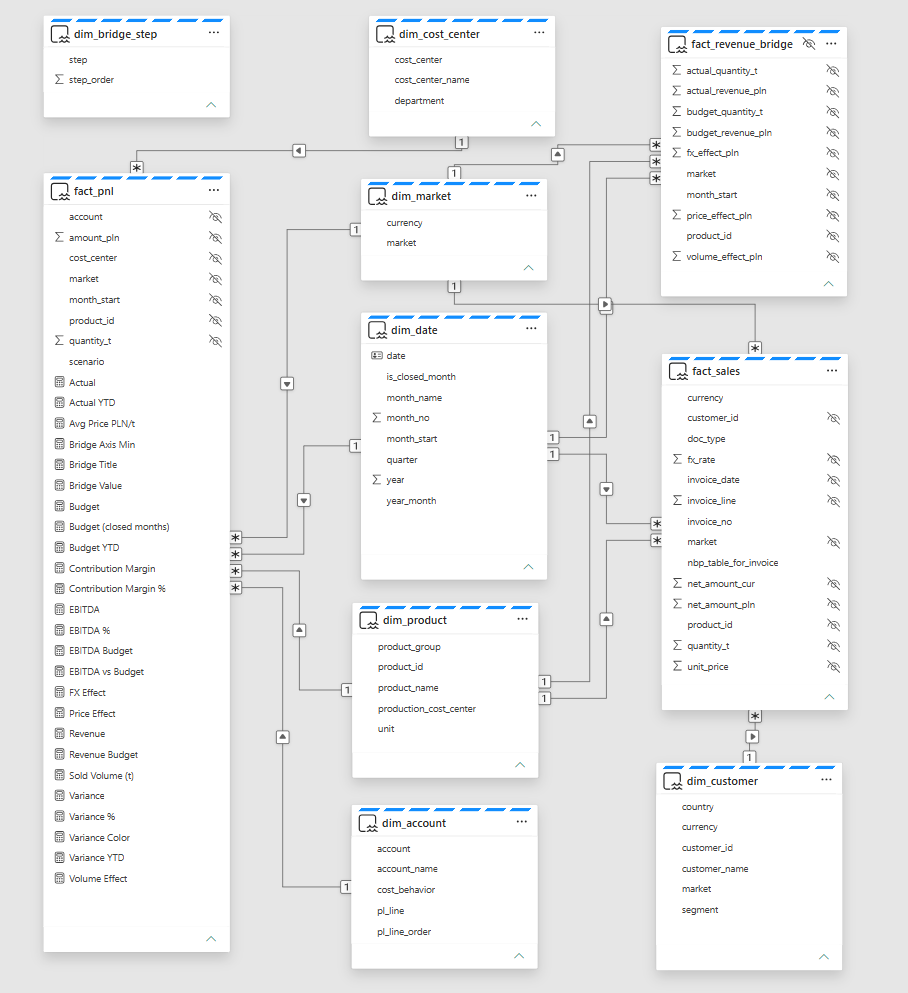

Lakehouse tables (bronze, silver, gold):

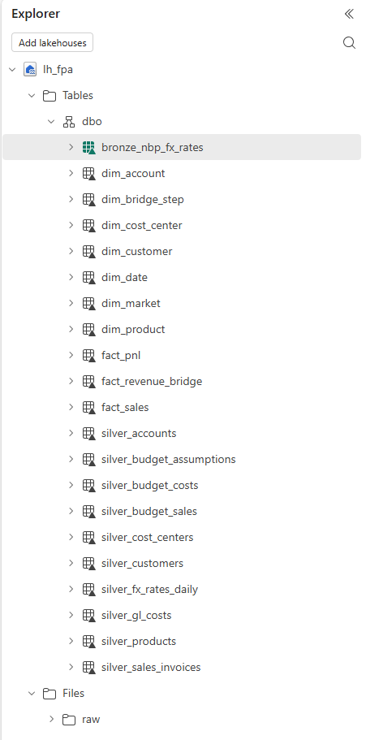

### Revenue bridge formulas

| Effect | Formula |
|---|---|
| Volume | (Q<sub>act</sub> − Q<sub>bud</sub>) × P<sub>bud</sub> × FX<sub>bud</sub> |
| Price | (P<sub>act</sub> − P<sub>bud</sub>) × Q<sub>act</sub> × FX<sub>bud</sub> |
| FX | (FX<sub>act</sub> − FX<sub>bud</sub>) × P<sub>act</sub> × Q<sub>act</sub> |

Budget + Volume + Price + FX = Actual.

## Extension: Sales plan 2027 with Fabric Plan and writeback

A prototype of **driver-based sales planning** built with **Fabric Plan** (Planning in Fabric IQ) on top of the same lakehouse. Planners adjust volumes and prices per product × market × currency × month; the plan is written back to a **Fabric SQL Database**, read again by the Direct Lake model and checked against **production capacity and stock** – a closed planning loop inside Fabric.


https://github.com/user-attachments/assets/62f5908f-d426-4e32-afac-34ab2f20e10e


*Demo (1 min): change the plan → writeback → stock alert → plan vs 2025 → EUR/PLN scenarios.*

### The planning loop

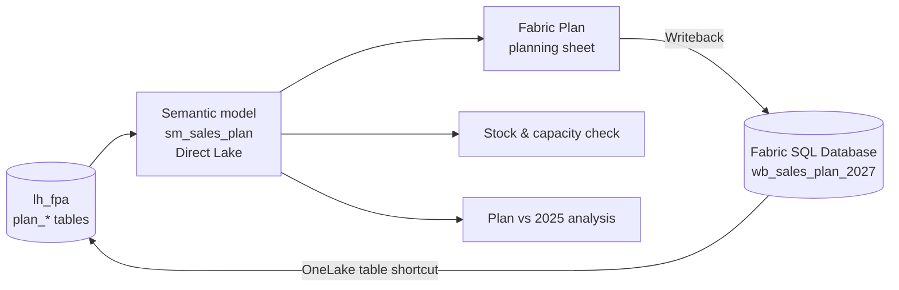

| Step | What happens |
|---|---|
| Inputs | Notebook `04_sales_plan_prep` builds `plan_*` tables: 2025 actuals by product × market × currency × month, a seed plan (2025 volumes +3%, prices +2%), monthly production capacity (ammonia plant turnaround in August), opening stock and storage limits, EUR/PLN scenarios |
| Planning | Planning sheet with two simulation measures (**Plan Qty**, **Plan Price**, ±30% / ±15% vs seed) and a formula measure **Plan Revenue PLN** = qty × price × EUR/PLN rate |
| Writeback | Long format, totals excluded, 2,016 rows per save to `dbo.wb_sales_plan_2027` in a Fabric SQL Database |
| Read back | Table shortcut in `lh_fpa`; DAX measures read the written plan with `TREATAS`, so the model needs no extra relationships |
| Checks | Closing stock = opening stock + cumulative capacity − cumulative plan; status **Shortage** / **Over storage** / **OK** with conditional formatting |
| Scenarios | Monthly EUR/PLN paths: Base 4.30 → 4.24, Strong PLN 4.22 → 4.10, Weak PLN 4.36 → 4.48 |

### Sheets

**Sales Volume & Price 2027** – planning grid; red markers show where the planner changed the seed (here: Urea, domestic market, March −10%).

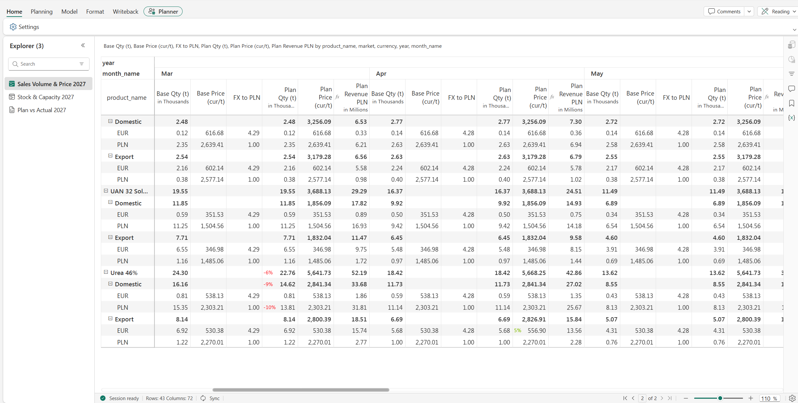

**Stock & Capacity 2027** – reads the written plan; a +10% change in Urea sales turns April stock negative and the sheet shows **Shortage** (see the video); the screenshot shows the final plan, with April at 0.63 kt.

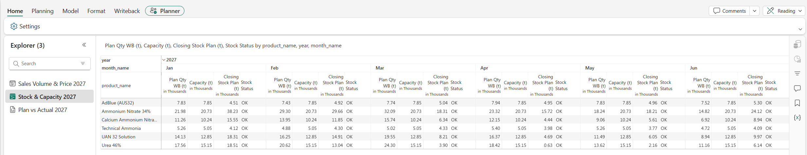

**Plan vs Actual 2027** – plan revenue **1,581.3 m PLN vs 1,503.0 m PLN in 2025 (+5.2%)**, volume +2.8%, average price per product, monthly comparison.

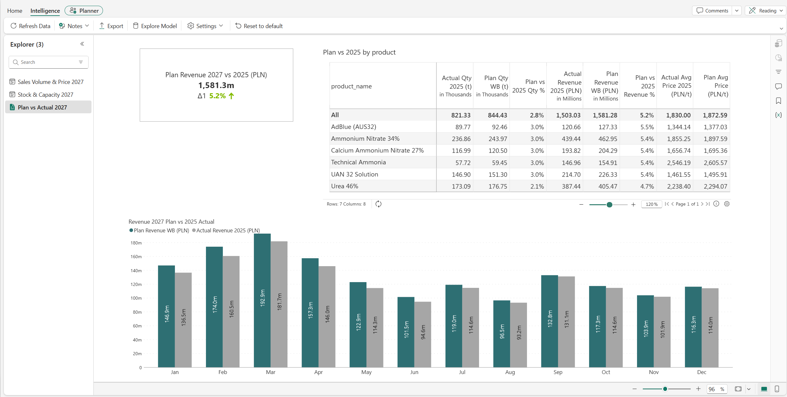

### Key DAX pattern – reading the written plan

```dax
Plan Qty WB (t) =
IF (
    MAX ( plan_dim_month[year] ) = 2027,
    CALCULATE (
        SUM ( wb_sales_plan_2027[Value] ),
        wb_sales_plan_2027[ValueColumnName] = "plan_qty_t",
        TREATAS ( VALUES ( dim_product[product_name] ), wb_sales_plan_2027[Product_name] ),
        TREATAS ( VALUES ( dim_market[market] ), wb_sales_plan_2027[Market] ),
        TREATAS ( VALUES ( plan_dim_currency[currency] ), wb_sales_plan_2027[Currency] ),
        TREATAS ( VALUES ( plan_dim_month[month_name] ), wb_sales_plan_2027[Month_name] )
    )
)

Closing Stock Plan (t) =
VAR _m = MAX ( plan_dim_month[month_start] )
RETURN
    IF (
        MAX ( plan_dim_month[year] ) = 2027,
        [Opening Stock (t)]
            + CALCULATE (
                [Capacity (t)] - [Plan Qty WB (t)],
                REMOVEFILTERS ( plan_dim_month ),
                plan_dim_month[month_start] <= _m,
                plan_dim_month[year] = 2027
            )
    )
```

### Lessons learned

* **Connections:** Fabric Plan needs a shared cloud connection to the semantic model. With a Direct Lake model the connection to the lakehouse must use fixed credentials (SSO for DirectQuery/Direct Lake switched off).
* **Simulation columns always sum in parent rows**, so prices are meaningful only at the lowest level; the average price is calculated in the analysis sheet instead.
* **Formula measures** must be inserted from the suggestion list, not typed by hand.
* **Writeback replaces** the previous version of the rows; column names are set once in the mapping, and renaming them later breaks the downstream measures.
* **Refresh:** after writeback the downstream sheets need a *Sync* / data refresh before they show the new plan.

Input files: `data/raw/plan/` · generator: `scripts/generate_plan_inputs.py` · notebook: `notebooks/04_sales_plan_prep.ipynb`

## Repository structure

```
├── data/raw/
│   ├── erp/            sales_invoices.csv, gl_cost_postings.csv
│   ├── budget/         budget_2025_2026.xlsx
│   ├── master_data/    products, customers, cost_centers, accounts
│   └── plan/           plan seed, capacity, opening stock, FX scenarios 2027
├── notebooks/
│   ├── 01_ingest_nbp_fx_rates.ipynb
│   ├── 02_bronze_to_silver.ipynb
│   ├── 03_silver_to_gold.ipynb
│   └── 04_sales_plan_prep.ipynb
├── semantic-model/     model description and DAX measures
├── scripts/            generate_data.py, generate_plan_inputs.py – synthetic data generators
├── media/              demo video of the sales plan
└── docs/images/        report screenshots
```

## How to run it

1. Create a Fabric workspace (trial capacity is enough) and a lakehouse `lh_fpa`.
2. Upload the `data/raw` folder to `Files/raw` in the lakehouse.
3. Import the three notebooks, attach `lh_fpa` as the default lakehouse and run them in order (or create a pipeline that runs them).
4. Create a Direct Lake semantic model on the gold tables, add relationships and measures from `semantic-model/`.
5. Build the report.
6. *Sales plan (optional):* upload `data/raw/plan` to `Files/raw/plan`, run notebook 04, create the `sm_sales_plan` model and a Fabric Plan item on top of it.

To regenerate the data: `pip install -r requirements.txt && python scripts/generate_data.py`

## Data disclaimer

All data is **synthetic** and generated by `scripts/generate_data.py` and `scripts/generate_plan_inputs.py`. The company, customers and all figures are fictional. The only real data are the public NBP exchange rates downloaded at run time.

## How this project was built

The business scenario, data model, DAX measures and report design are my own work, based on my experience in controlling and FP&A. I used an AI assistant (Claude) to help generate the synthetic dataset and the first version of the notebook code, which I then reviewed, ran and adjusted in Fabric. The sales plan extension (planning sheets, writeback, stock check, measures) was configured and tested by me in Fabric Plan; the AI assistant helped with the input data generator, DAX drafts and editing the demo video.

## Skills demonstrated

Microsoft Fabric · Lakehouse · Medallion architecture · PySpark · Delta tables · Data Factory pipelines · Direct Lake · Power BI · DAX · Dimensional modeling · REST API ingestion · Fabric Plan · Writeback · Fabric SQL Database · OneLake shortcuts · FP&A: budget vs actual, variance analysis, P&L, driver-based planning, scenario analysis

---

**Author:** Krzysztof Wiejak – Controlling & FP&A | Microsoft Certified: Power BI Data Analyst (PL-300), Fabric Analytics Engineer (DP-600)
[LinkedIn](https://www.linkedin.com/in/krzysztofwiejak)
