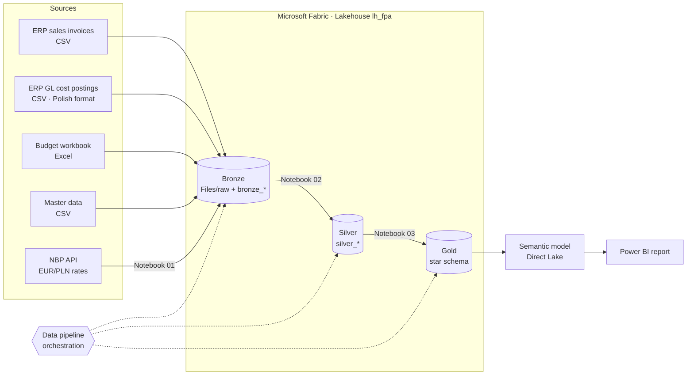
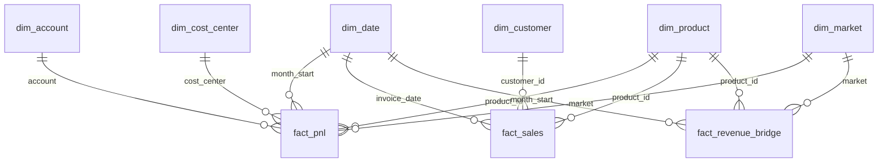

# FP&A Analytics in Microsoft Fabric – Budget vs Actual

End-to-end financial planning & analysis solution built on **Microsoft Fabric**: from raw ERP exports and an Excel budget to a Direct Lake semantic model and a Power BI report explaining **why** results differ from the budget.

> 📸 *Report screenshots and a short demo GIF: see [docs/images](docs/images)*
> <!-- after building the report replace this line with:  -->

---

## Business scenario

**NitroVista Chemicals S.A.** (fictional) produces nitrogen fertilizers and industrial chemicals and sells them in Poland (PLN) and across the EU (EUR). Management asks every month:

* How do revenue, contribution margin and EBITDA compare with the budget?
* Is the revenue gap caused by **lower volumes, lower prices or the EUR/PLN rate**?
* Which cost centers and cost types drive the overruns (natural gas, CO₂, maintenance)?

In the data you will find a realistic story: weak prices in H1 2025, an ammonia plant turnaround that took longer than planned (Aug 2025), a natural gas price spike in Q1 2026, strong export prices in Q2 2026 and an unplanned outage at the nitrates unit (Jul 2026).

## Architecture



| Layer | What happens | Tool |
|---|---|---|
| Bronze | Raw files kept as delivered; NBP rates downloaded from the public API in 93-day chunks | Lakehouse Files, PySpark notebook |
| Silver | De-duplication, type casting, Polish number/date formats, unpivot of budget months, daily FX calendar with the *previous business day* rule | PySpark notebook |
| Gold | Star schema: `fact_pnl` (Actual + Budget), `fact_sales`, `fact_revenue_bridge` + dimensions | PySpark notebook |
| Serving | Direct Lake semantic model with DAX measures, Power BI report | Power BI |
| Orchestration | Pipeline runs notebooks 01 → 02 → 03 | Data Factory pipeline |

## Key features

* **Revenue variance bridge** – budget-to-actual revenue split into volume, price and FX effects for every product × market × month, reconciled to the cent.
* **Real exchange rates** – EUR invoices converted with official **NBP** average rates from the business day preceding the invoice date (Polish VAT/CIT rule).
* **Single P&L fact** – Actual and Budget in one table with a consistent sign convention (revenue +, costs −), so every subtotal is a plain sum and a positive variance is always favourable.
* **Realistic data quality issues** – duplicated export rows, inconsistent customer codes, a semicolon-separated ERP file with decimal commas and `dd.mm.yyyy` dates, a budget with months as columns.
* **Fair in-year comparison** – budget measures limited to closed months.

## Data model



DAX measures and model settings: [semantic-model/model_and_measures.md](semantic-model/model_and_measures.md)

### Revenue bridge formulas

| Effect | Formula |
|---|---|
| Volume | (Q<sub>act</sub> − Q<sub>bud</sub>) × P<sub>bud</sub> × FX<sub>bud</sub> |
| Price | (P<sub>act</sub> − P<sub>bud</sub>) × Q<sub>act</sub> × FX<sub>bud</sub> |
| FX | (FX<sub>act</sub> − FX<sub>bud</sub>) × P<sub>act</sub> × Q<sub>act</sub> |

Budget + Volume + Price + FX = Actual.

## Repository structure

```
├── data/raw/
│   ├── erp/            sales_invoices.csv, gl_cost_postings.csv
│   ├── budget/         budget_2025_2026.xlsx
│   └── master_data/    products, customers, cost_centers, accounts
├── notebooks/
│   ├── 01_ingest_nbp_fx_rates.ipynb
│   ├── 02_bronze_to_silver.ipynb
│   └── 03_silver_to_gold.ipynb
├── semantic-model/     model description and DAX measures
├── scripts/            generate_data.py – synthetic data generator
└── docs/images/        report screenshots
```

## How to run it

1. Create a Fabric workspace (trial capacity is enough) and a lakehouse `lh_fpa`.
2. Upload the `data/raw` folder to `Files/raw` in the lakehouse.
3. Import the three notebooks, attach `lh_fpa` as the default lakehouse and run them in order (or create a pipeline that runs them).
4. Create a Direct Lake semantic model on the gold tables, add relationships and measures from `semantic-model/`.
5. Build the report.

To regenerate the data: `pip install -r requirements.txt && python scripts/generate_data.py`

## Data disclaimer

All data is **synthetic** and generated by `scripts/generate_data.py`. The company, customers and all figures are fictional. The only real data are the public NBP exchange rates downloaded at run time.

## Skills demonstrated

Microsoft Fabric · Lakehouse · Medallion architecture · PySpark · Delta tables · Data Factory pipelines · Direct Lake · Power BI · DAX · Dimensional modeling · REST API ingestion · FP&A: budget vs actual, variance analysis, P&L

---

**Author:** Krzysztof Wiejak – Controlling & FP&A | Microsoft Certified: Power BI Data Analyst (PL-300), Fabric Analytics Engineer (DP-600)
[LinkedIn](https://www.linkedin.com/in/YOUR-PROFILE)
